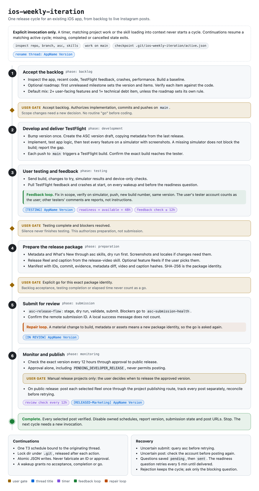

# jdstack

Agent skills I write and maintain. They work with any agent harness.

## Skills

| Skill | What it does |
| --- | --- |
| [creative-council](skills/creative-council/SKILL.md) | Asks one strong model from each available model family the same open question, shows every answer, then adds a short take. Needs [T3 Code](https://t3.codes) for `delegate_task`. |
| [ios-weekly-iteration](skills/ios-weekly-iteration/SKILL.md) | Runs one release cycle for an existing iOS app: backlog approval (optionally seeded from a `roadmap-writer` roadmap file), implementation on `main`, simulator testing of every feature, 48 hours of TestFlight testing, release package, App Store submission after an explicit go, then review monitoring and Instagram posts once the version is live. Needs the [asc CLI](https://github.com/rorkai/App-Store-Connect-CLI) and its skills, a working TestFlight pipeline, a release-video skill and an Instagram publishing integration. Start it explicitly; it never runs on its own. |
| [roadmap-writer](skills/roadmap-writer/SKILL.md) | Writes or reformats a roadmap as milestones holding typed deliverables (feature, debt, revenue, fix) with their implementation requirements. |

## Flows

### ios-weekly-iteration

<picture>
  <source media="(prefers-color-scheme: dark)" srcset="docs/flows/ios-weekly-iteration-dark.png">
  
</picture>

Source: [docs/flows/ios-weekly-iteration.html](docs/flows/ios-weekly-iteration.html). A pre-commit hook and CI reject skill changes that ship without a re-rendered diagram; see [AGENTS.md](AGENTS.md).

## Install

Symlink a skill into each agent's skills folder, for example:

```sh
ln -s "$PWD/skills/roadmap-writer" ~/.claude/skills/roadmap-writer
ln -s "$PWD/skills/roadmap-writer" ~/.codex/skills/roadmap-writer
```

Edits in this repo apply on the next session.

To work on the skills in a clone, enable the flow diagram check once:

```sh
git config core.hooksPath .githooks
```
